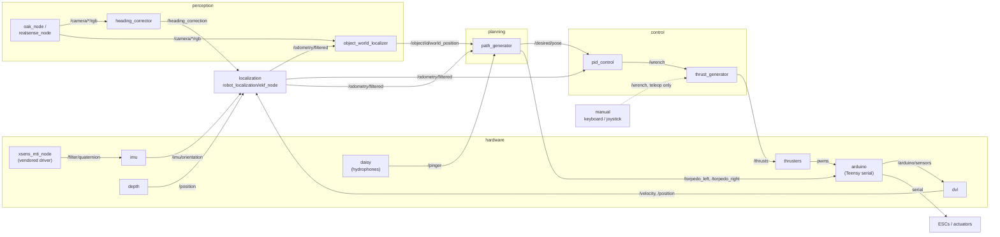

# RoboSub

Stanford RoboSub's autonomy stack for our AUV. A **colcon workspace** of ROS 2 **Humble**
packages under `src/`, running on a Jetson AGX Orin in a single conda environment.

**Start here:** [Clone the repo](#clone-the-repo) → [SSH into the sub](#ssh-into-the-sub) →
[Activate the environment](#activate-the-environment) → [Run it](#running) →
the [package docs](#packages) for whatever you are working on.

---

## Packages

Every package has its own doc covering its nodes, what each one publishes and subscribes
to, and its entry points.

| Package | Doc | What it does |
|---|---|---|
| **main** | [src/main/README.md](src/main/README.md) | Launch files only. Composes the subsystems into a running vehicle. No nodes of its own. |
| **msgs** | [src/msgs/README.md](src/msgs/README.md) | Every custom `.msg` / `.srv`. No nodes — all other packages depend on it. |
| **hardware** | [src/hardware/README.md](src/hardware/README.md) | Everything that touches a device: IMU, DVL, depth, hydrophones, Teensy serial, thruster PWM, and the run dashboard. |
| **localization** | [src/localization/README.md](src/localization/README.md) | Config home for the external `robot_localization` EKF. Not a colcon package. |
| **control** | [src/control/README.md](src/control/README.md) | Pose setpoint → PID → body wrench → per-thruster thrust allocation. |
| **planning** | [src/planning/README.md](src/planning/README.md) | Mission YAML → offline bake → 60 Hz pose setpoints, with branch decisions and actuator triggers. |
| **perception** | [src/perception/README.md](src/perception/README.md) | OAK / RealSense drivers, aligned depth, YOLO detection → world-frame object goals, bottom-line heading correction. |
| **manual** | [src/manual/README.md](src/manual/README.md) | Keyboard and joystick teleop over NATS. |
| **gui** | [src/gui/README.md](src/gui/README.md) | WebSocket bridge + browser HUD. |
| **simulation** | [src/simulation/README.md](src/simulation/README.md) | Gazebo stand-in for `hardware`. Not built on the vehicle. |
| **testing** | [src/testing/README.md](src/testing/README.md) | Standalone Dash topic explorer. Not a colcon package. |
| **xsens_mti_ros2_driver** | [src/xsens_mti_ros2_driver/README.md](src/xsens_mti_ros2_driver/README.md) | Vendored Xsens MTi driver. Read-only. |
| **nmea_msgs** | [src/nmea_msgs/README.md](src/nmea_msgs/README.md) | Vendored interfaces (no py3.10 conda build). Read-only. |
| **mavros_msgs** | [src/mavros_msgs/README.md](src/mavros_msgs/README.md) | Vendored interfaces (no py3.10 conda build). Read-only. |

`src/yolo_ros/` is an empty, orphaned submodule gitlink with no `.gitmodules` — nothing
uses it. YOLO lives in `perception`.

---

## How the packages fit together

The whole stack is four topics wide. Sensors converge on `/odometry/filtered`; the mission
emits `/desired/pose`; control turns the gap between them into `/wrench`; allocation and
hardware turn that into PWM.



### The interfaces that matter

| Topic | Type | Written by | Read by |
|---|---|---|---|
| `/imu/orientation` | `sensor_msgs/Imu` | `hardware/imu` | EKF, `perception/heading_corrector` |
| `/velocity` | `TwistWithCovarianceStamped` | `hardware/dvl` | EKF, `hardware/sensors_plot` |
| `/position` | `PoseWithCovarianceStamped` | `hardware/depth`, `hardware/dvl` | EKF |
| `/heading_correction` | `PoseWithCovarianceStamped` | `perception/heading_corrector` | EKF |
| `/odometry/filtered` | `nav_msgs/Odometry` | EKF | `control`, `planning`, `perception`, plots |
| `/desired/pose` | `nav_msgs/Odometry` | `planning/path_generator` | `control/pid_control` |
| `/wrench` | `geometry_msgs/WrenchStamped` | `control/pid_control` **or** `manual/*` | `control/thrust_generator` |
| `/thrusts` | `msgs/ThrustsStamped` | `control/thrust_generator` | `hardware/thrusters`, `simulation/thrusters` |
| `pwms` | `msgs/PWMsStamped` | `hardware/thrusters` | `hardware/arduino` |
| `/arduino/sensors` | `msgs/SensorsStamped` | `hardware/arduino` | `hardware/depth`, `hardware/dvl`, `hardware/sensors_plot` |
| `/mission/stage` | `std_msgs/String` | `planning/path_generator` | `hardware/sensors_plot` |

### Substitution points

Three nodes can each stand in for a whole subsystem — handy, and dangerous if doubled up.
**Exactly one** publisher of `/odometry/filtered` and **exactly one** of `/wrench` may run
at a time:

| Instead of | Run | Gives you |
|---|---|---|
| real sensors + EKF | `control/fake_localizer` | laptop-only control loop (integrates `/wrench`) |
| real sensors + EKF | `simulation/sensors` | Gazebo ground truth as odometry |
| `planning` + `control` | `manual/keyboard` | operator teleop |

---

## Clone the repo

```bash
git clone git@github.com:Stanford-AUV/RoboSub.git     # SSH (needs a key on your GitHub account)
# or: git clone https://github.com/Stanford-AUV/RoboSub.git
cd RoboSub
```

This repository **is** the colcon workspace — `build.sh`, `src/`, and the generated
`build/`, `install/`, `log/` all live at its root. Do not nest it inside another
`ros2_ws/src/`.

`src/nmea_msgs`, `src/mavros_msgs`, and `src/xsens_mti_ros2_driver` are vendored in-tree,
so a plain clone is complete. There are no submodules to initialize.

---

## SSH into the sub

The vehicle computer is a **Jetson AGX Orin**, user **`robosub`**. Two paths to it:

| Route | Address | When |
|---|---|---|
| **Tether** (USB-ethernet, point-to-point `192.168.2.0/24`) | `robosub@192.168.2.2` | pool runs, anything with the sub in the water |
| **LAN / WiFi** | `robosub@192.168.1.17` | bench work in the lab |

Add this to your `~/.ssh/config` so the names work everywhere:

```sshconfig
Host robosub-tether
    HostName 192.168.2.2
    User robosub

Host robosub
    HostName 192.168.1.17
    User robosub
```

```bash
ssh robosub-tether          # or: ssh robosub
```

**Useful variants:**

```bash
# Forward the run dashboard (hardware/sensors_plot) to your laptop
ssh -L 8080:localhost:8080 robosub-tether      # then open http://localhost:8080

# Forward the WebSocket HUD + its page server
ssh -L 8080:localhost:8080 -L 9091:localhost:9091 robosub-tether

# X11 for the matplotlib debug nodes (path_streamer, imu_plot, camera_viewer)
ssh -X robosub-tether
```

The LAN address can change; the tether address is fixed by the point-to-point link. Always
run long missions inside `tmux` so a dropped tether does not kill the stack.

> The conda env is a prefix on disk, not an exclusive container, so **several people can
> SSH in and `conda activate robosub` at once**. What is still exclusive: the serial
> devices (one process per port) and the DDS graph.

---

## Activate the environment

Everything — ROS 2 Humble, Python, GPU PyTorch — comes from one conda env named
**`robosub`**. There is no Docker and no `/opt/ros` to source.

```bash
source ~/miniforge3/etc/profile.d/conda.sh   # needed in non-interactive shells
conda activate robosub
cd ~/RoboSub
source install/setup.bash                    # the workspace overlay, in every new shell
```

Verify:

```bash
echo $CONDA_DEFAULT_ENV      # robosub
ros2 pkg list | grep -c .    # non-zero
python -c "import torch; print(torch.cuda.is_available())"   # True on the Orin
```

Activating `robosub` also sets `LD_LIBRARY_PATH` (host CUDA/tegra for GPU torch **and**
`$CONDA_PREFIX/lib` for the colcon-built C++ nodes), `PYTHONNOUSERSITE=1`, and
`ROS_DOMAIN_ID`, via a `conda/activate.d` hook.

**Setting the env up from scratch** (new Orin, or your own machine) is in
**[ORIN_SETUP.md](ORIN_SETUP.md)** — it also doubles as the log of every non-obvious gotcha
we have hit. Short version: Miniforge → `conda create -n robosub python=3.10` from
RoboStack Humble channels → prebuilt Jetson torch wheels → `python -m pip install -r
requirements.txt` → `bash drivers/xsens_mt/install.sh` for the IMU kernel module.

> Always `python -m pip install`, never bare `pip` — a stray `~/.local/bin/pip` shadows the
> env's pip and the packages silently fail to import.

---

## Build

From the repository root:

```bash
./build.sh && source install/setup.bash
```

On the vehicle, `simulation` is skipped (it needs Gazebo Harmonic, which the Humble env
does not have):

```bash
colcon build --packages-skip simulation --symlink-install
```

`jobserver unavailable` warnings from parallel builds are safe to ignore. Config YAMLs are
installed as data files, so **rerun the build after editing a YAML** or the nodes will read
a stale copy out of the install tree.

> **Known breakage:** `build.sh` (and `launch_sub.sh`, and `run_experiment.sh`) end by
> calling `tools/symlink_yamls.sh`, which is **not in the repository** — it was never
> committed. `build.sh` runs under `set -e` and `launch_sub.sh` treats the failure as
> fatal, so both abort at that step on a fresh clone. Until it is restored, build with
> `colcon build --merge-install --symlink-install --base-paths .` directly, and re-run the
> build after any YAML edit instead of relying on the symlinks.

---

## Running

### Full autonomy (what you use at the pool)

```bash
./launch_sub.sh                      # default mission: segments.yaml
./launch_sub.sh semifinals.yaml      # pick a mission
./launch_sub.sh --no-thrust          # bench: PWMs pinned to neutral, motors never spin
```

`launch_sub.sh` activates the conda env itself, re-bakes the mission YAML, exports the
async Fast DDS profile, brings the stack up in three phases (IMU settle → base stack →
planning), records a rosbag to `bags/`, and on `Ctrl+C` shuts everything down and sends
neutral PWM (1500) to every thruster. Watch the run at **http://192.168.2.2:8080**.

Teardown and diagnostics: [`kill_sub.sh`](kill_sub.sh), [`logs.sh`](logs.sh),
[`ports.sh`](ports.sh).

### Individual launch files

```bash
ros2 launch main main.py         # imu + hardware + localization + control
ros2 launch main hardware.py     # device I/O + thrust pipeline + dashboard
ros2 launch main localization.py # EKF + static TFs
ros2 launch main control.py      # pid_control + logger
ros2 launch main planning.py waypoints_path:=segments.yaml
ros2 launch main perception.py
ros2 launch main manual.py       # bench teleop
```

See [src/main/README.md](src/main/README.md) for what each one contains and the
composition rules (which files conflict, and why `thrust_generator` lives in `hardware.py`).

### Single node

```bash
ros2 run <package> <executable>
ros2 run control thrust_generator
ros2 run manual keyboard
```

Executable names are the `console_scripts` in each package's `setup.py`, listed in each
package doc. A new Python node goes under `<package>/nodes/`, gets registered in
`setup.py`, and needs a rebuild.

### Teleop

```bash
# on the sub
nats-server &
ros2 launch main hardware.py
ros2 run manual keyboard
# on your laptop, from the repo root
./keyboard_local.sh
```

Stop teleop before starting autonomy — `manual/keyboard` and `control/pid_control` both
publish `/wrench`. Details and the key map: [src/manual/README.md](src/manual/README.md).

### Recording and playback

```bash
./record_all.sh PATH       # everything
./record_important.sh PATH # the topics you usually want
./record_cameras.sh PATH   # image topics only
ros2 bag play PATH
```

`launch_sub.sh` already records every run to `bags/` (`ROSBAG=0` to skip).

### Inspecting a live system

```bash
ros2 topic list
ros2 topic hz /odometry/filtered /wrench /thrusts
ros2 run rqt_graph rqt_graph
```

---

## Pool-day sensor preflight

Confirm data is flowing before anything goes in the water.

```bash
ros2 launch main imu.py          # Xsens + hardware/imu; let it settle ~20 s
ros2 launch main hardware.py     # dvl, depth, arduino, daisy, thrust pipeline, dashboard
```

Then check each link in the chain:

```bash
ros2 topic hz /filter/quaternion    # Xsens driver alive
ros2 topic hz /imu/orientation      # hardware/imu republishing
ros2 topic hz /velocity /position   # DVL + depth
ros2 topic echo /arduino/sensors --once   # Teensy telemetry: depth, temps, current, voltage
ros2 topic hz /pinger/levels        # hydrophones
```

Open **http://192.168.2.2:8080** for all of it at once (`hardware/sensors_plot`). Expected
behaviour: tilt the hull and orientation tracks; `/velocity` sits near zero on the bench
and only tracks motion with a bottom lock in water; `/position` z follows depth.

**Safety:** `hardware.py` starts `thrust_generator` and `thrusters` — treat it as a
powered vehicle, not a passive logger. Keep props clear, and use `--no-thrust` for dry
checks.

| Symptom | Likely cause |
|---|---|
| no `/filter/quaternion` | Xsens kernel module missing (`bash drivers/xsens_mt/install.sh`), USB, or permissions |
| no `/velocity` | DVL serial path (`/dev/ttyUSB_dvl`), power, or no acoustic lock |
| `arduino` fails to open the port | Teensy not on `/dev/ttyACM_teensy` — check the udev rule, not a bare `ttyACM<n>` |
| yaw drifts and never recovers | `heading_corrector` not running; see `hardware/ekf_watchdog` for the divergence reset |
| permission denied on serial | run `./ports.sh`, and add your user to `dialout` |
| no matplotlib window | no `DISPLAY` — use `ssh -X`, or the port-8080 dashboard instead |

---

## Simulation

Gazebo Harmonic, on a separate machine — **not** part of the vehicle runtime env. See
[SIMULATION.md](SIMULATION.md) and [src/simulation/README.md](src/simulation/README.md).

---

## Repository layout

```text
RoboSub/                        # colcon workspace root
├── launch_sub.sh               # full-stack bring-up + safe teardown (the real entry point)
├── kill_sub.sh  logs.sh  ports.sh  test.sh  build.sh
├── run_experiment.sh           # tmux IMU+thrust bench rig
├── record_*.sh                 # rosbag helpers
├── keyboard_local.sh  joystick_local.sh   # operator-side teleop (laptop, .local_venv)
├── sim_local.sh  sim_docker.sh
├── config/fastdds_async.xml    # async DDS profile — fixes EKF stalls on tether loss
├── drivers/xsens_mt/           # out-of-tree IMU kernel module
├── tools/                      # bake_path.py, tether_monitor.py, wrench_sweep.py, undistort/, allan_variance/
├── references/                 # design report + system diagrams
├── yolo-Weights/               # YOLO model files
├── ORIN_SETUP.md  SIMULATION.md
└── src/                        # the packages — see the table above
```

Generated by colcon: `build/`, `install/`, `log/`.

---

## Testing

```bash
./test.sh                                 # whole workspace
colcon test --packages-select control     # one package
ament_pep257                              # docstring lint detail
```

---

## Contributing

- Target **ROS 2 Humble** APIs. Much of what you find online is for other distros.
- New interfaces go in `src/msgs` (and into `CMakeLists.txt`), then rebuild before use.
- New nodes go in `<package>/nodes/`, get registered in that package's `setup.py`, and get
  documented in that package's `README.md` — including what they publish and subscribe to.
- Tests go under `<package>/test/`.
- Keep PRs scoped to one subsystem.

## Troubleshooting

**Low disk space.** Keep ≥ ~30 GB free for the conda env, builds, bags, and logs. A clean
rebuild: `rm -rf build install log && ./build.sh`.

**A node reads an old config.** Config YAMLs install as data files, and colcon copies
them even under `--symlink-install`. Rebuild after editing one. (The
`tools/symlink_yamls.sh` the build scripts expect is missing — see
[Build](#build).)

**`ros2 topic echo` sees nothing that is clearly publishing.** A stale `ros2` CLI daemon
may be pinned to a different `ROS_DOMAIN_ID`: `ros2 daemon stop`, then retry.

**Qt / `xcb` plugin errors.** Restart the session; for remote plots prefer the port-8080
dashboard over X11 forwarding.

**The EKF freezes for seconds at a time.** Export the async DDS profile
(`FASTRTPS_DEFAULT_PROFILES_FILE=config/fastdds_async.xml`); `launch_sub.sh` does this for
you. The full diagnosis is in that file's header comment.

## License

The `license` field in each `package.xml` is the source of truth until a repo-wide policy
is set. Vendored packages keep their upstream licenses.
